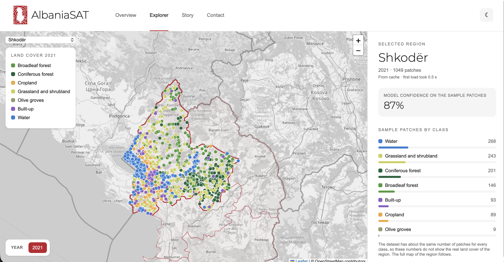
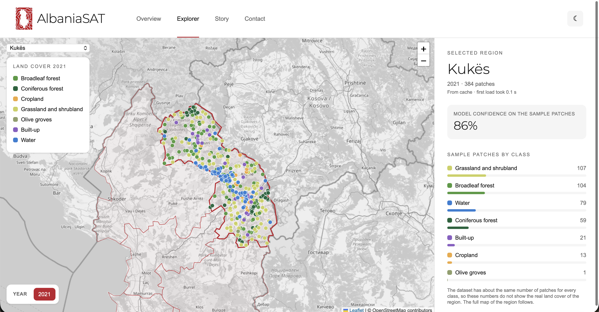
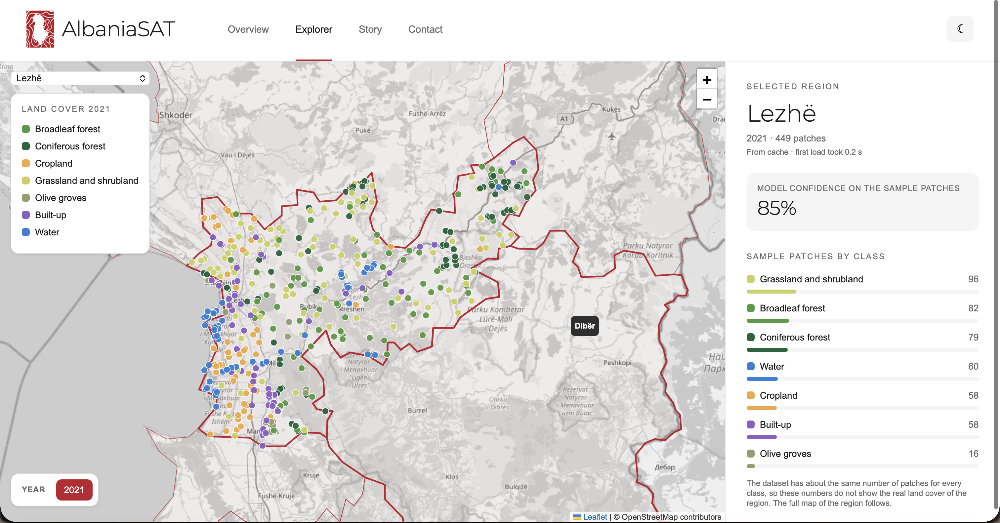
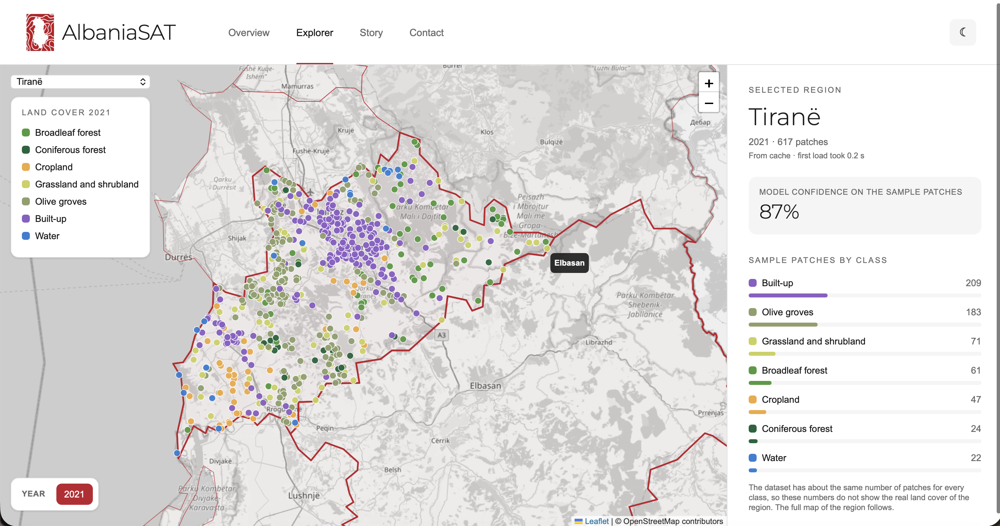

# Testprotokoll: Ladezeit der interaktiven Karte (Ziel M-3.3)

**Datum:** 16.11.2026
**Testerin:** Suisa Shehi
**Anforderung:** Klick auf eine Region lädt Klassifikationsdaten und Sentinel-2-Bilder aus der API in unter drei Sekunden.

## Ablauf

Explorer öffnen, Region in der Liste oder auf der Karte wählen, die angezeigte Ladezeit ablesen. Die Zeit wird im Browser gemessen, vom Start der Anfrage bis die Patches und die Zusammenfassung angekommen sind. Danach dieselbe Region noch einmal öffnen, um den Cache zu prüfen.

Getestet wurde lokal (Frontend auf localhost, Daten aus Supabase) und auf der Live-Seite https://albaniasat.onrender.com.

## Ergebnisse

| Region | Patches | Ladezeit lokal | Ladezeit live | Ergebnis |
|---|---|---|---|---|
| Shkodër | 1049 | 0,4 s | 0,5 s | bestanden |
| Kukës | 384 | 0,4 s | 0,1 s | bestanden |
| Lezhë | 449 | 0,3 s | 0,2 s | bestanden |
| Tiranë | 617 | 0,4 s | 0,2 s | bestanden |

**Cache:** Beim zweiten Öffnen einer Region erscheinen die Patches sofort, ohne neue Anfrage an die API („From cache“).

**Hinweis:** Das Backend läuft im Gratis-Tarif von Render. Nach 15 Minuten ohne Anfragen schläft der Server, und die erste Anfrage danach dauert 30 bis 60 Sekunden. Die Messungen wurden mit laufendem Server gemacht.

## Ergebnis

Alle gemessenen Regionen laden lokal und live in unter einer Sekunde. Die Anforderung von unter drei Sekunden ist erfüllt.

## Screenshots

### Live

### Lokal

